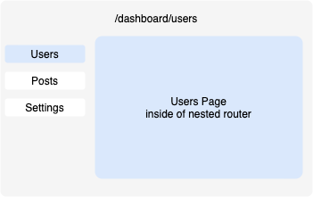
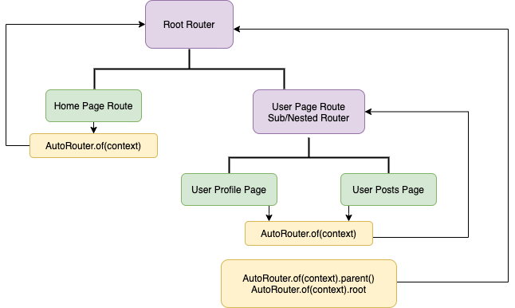

<p align="center">
  
</p>

<p align="center">
  <a href="https://img.shields.io/badge/License-MIT-green">
    
  </a>
  <a href="https://github.com/Milad-Akarie/auto_route_library/stargazers">
    
  </a>
  <a href="https://pub.dev/packages/auto_route">
    
  </a>
  <a href="https://discord.gg/x3SBU4WRRd">
    
  </a>
</p>

<p align="center">
  <a href="https://www.buymeacoffee.com/miladakarie" target="_blank">
    
  </a>
</p>

---

- [Introduction](#introduction)
  - [Installation](#installation)
  - [Setup and Usage](#setup-and-usage)
  - [Usage without code generation](#usage-without-code-generation)
- [Generated routes](#generated-routes)
- [Navigation](#navigating-between-screens)
  - [Navigating Between Screens](#navigating-between-screens)
  - [Passing Arguments](#passing-arguments)
  - [Returning Results](#returning-results)
  - [Nested navigation](#nested-navigation)
  - [Tab Navigation](#tab-navigation)
    - [Using PageView](#using-pageview)
    - [Using TabBar](#using-tabbar)
  - [Finding The Right Router](#finding-the-right-router)
  - [Navigating Without Context](#navigating-without-context)
- [Deep Linking](#deep-linking)
- [Declarative Navigation](#declarative-navigation)
- [Working with Paths](#working-with-paths)
- [Route Meta](#route-meta)
- [Route guards](#route-guards)
- [Wrapping routes](#wrapping-routes)
- [Navigation Observers](#navigation-observers)
- [Customization](#customizations)
  - [Custom Route Transitions](#custom-route-transitions)
  - [Custom Route Builder](#custom-route-builder)
- [Others](#others)
  - [Including Micro/External Packages](#including-microexternal-packages)
  - [Configuring builders](#configuring-builders)
    - [Optimizing Generation Time](#optimizing-generation-time)
    - [Enabling Cached Builds (Experimental)](#enabling-cached-builds)
  - [AutoLeadingButton-BackButton](#autoleadingbutton-backbutton)
  - [ActiveGuardObserver](#activeguardobserver)
  - [Android Predictive Back](#android-predictive-back)
  - [State Restoration](#state-restoration)
- [Examples](#examples)

## Migration guides

- [Migrating to v9](https://github.com/Milad-Akarie/auto_route_library/blob/master/migrations/migrating_to_v9.md)
- [Migrating to v6](https://github.com/Milad-Akarie/auto_route_library/blob/master/migrations/migrating_to_v6.md)

## Old documentation

- [Pre v9 documentation](https://github.com/Milad-Akarie/auto_route_library/blob/master/old/pre_v9_README.md)
- [Pre v6 documentation](https://github.com/Milad-Akarie/auto_route_library/blob/master/old/pre_v6_README.md)

## Introduction

#### What is AutoRoute?

It’s a Flutter navigation package, it allows for strongly-typed arguments passing, effortless deep-linking and it uses code generation to simplify routes setup. With that being said, it requires a minimal amount of code to generate everything needed for navigation inside of your App.

#### Why AutoRoute?

If your App requires deep-linking or guarded routes or just a clean routing setup, you'll need to use named/generated routes and you’ll end up writing a lot of boilerplate code for mediator argument classes, checking for required arguments, extracting arguments and a bunch of other stuff. **AutoRoute** does all that for you and much more.

## Installation

Add the following dependencies to your `pubspec.yaml` file:


 ```yaml
dependencies:
  auto_route: ^12.3.0

dev_dependencies:
  auto_route_generator: ^11.3.0
  build_runner:
```

```terminal
flutter pub add auto_route dev:auto_route_generator dev:build_runner
```

## Setup And Usage

1. Create a router class and annotate it with `@AutoRouterConfig` then extend "RootStackRouter" from The auto_route package
2. Override the routes getter and start adding your routes.

```dart
@AutoRouterConfig()
class AppRouter extends RootStackRouter {

  @override
  List<AutoRoute> get routes => [
    /// routes go here
  ];
}
```

### Using part builder

To generate a part-of file simply add a `part` directive to your `AppRouter`.

**Note:** The `deferredLoading` functionality does not work with part-file setup.

### Generating Routable pages

Routable pages are just simple everyday widgets annotated with `@RoutePage()` which allows them to be constructed by the router.

```dart
@RoutePage()
class HomeScreen extends StatefulWidget {}
```

#### Now simply run the generator

Use the [watch] flag to watch the files' system for edits and rebuild as necessary.

```terminal
dart run build_runner watch
```

If you want the generator to run one time and exit, use

```terminal
dart run build_runner build
```

#### Add the generated route to your routes list

```dart
@AutoRouterConfig(replaceInRouteName: 'Screen|Page,Route')
class AppRouter extends RootStackRouter {

  @override
  RouteType get defaultRouteType => RouteType.material(); //.cupertino, .adaptive ..etc

  @override
  List<AutoRoute> get routes => [
    // HomeScreen is generated as HomeRoute because
    // of the replaceInRouteName property
    AutoRoute(page: HomeRoute.page),
  ];

  @override
  List<AutoRouteGuard> get guards => [
    // optionally add root guards here
  ];
}
```

#### Finalize the setup

After you run the generator, your router class will be generated. Then simply hook it up with your MaterialApp.

```dart
// assuming this is the root widget of your App
class App extends StatelessWidget {
  // make sure you don't initiate your router
  // inside of the build function.
  final _appRouter = AppRouter();

  @override
  Widget build(BuildContext context){
    return MaterialApp.router(
      routerConfig: _appRouter.config(),
    );
  }
}
```
## Usage without code generation
You can use auto_route without code generation by providing an inline `NamedRouteDef` with a page builder function, as name suggests, you must provide a name for the route so you can navigate to it later by name or path.
### Declaring Named Routes
```dart
  NamedRouteDef(
    name: 'BookDetailsRoute',
    path: '/books/:id', // optional
    builder: (context, data) {
      return BookDetailsPage(id: data.params.getInt('id'));
    },
  ),
```
`NamedRouteDef` is a wrapper around `AutoRoute` that allows you to provide a page builder function instead of a generated page, it has the same properties as `AutoRoute` except for `page` properties.

**Tip:** use the shorthand version of NamedRouteRef for a cleaner look
```dart
   routes: [
     .named('HomeRoute', (ctx, data) => HomePage()),
     .named('BookListRoute', (ctx, data) => BookListPage()),
    ];
```

### Navigating to Named Routes
You can either navigate to a named route by using the dynamic `NamedRoute` class to match by name or by using the `pushPath` method to match by path.
```dart
 /// match by name
    router.push(NamedRoute('BookDetailsRoute', params: {'id': 1}));
    router.replace(NamedRoute('BookDetailsRoute', params: {'id': 1}));
    router.navigate(NamedRoute('BookDetailsRoute', params: {'id': 1}));
 /// or use the shorthand version
    router.push(.named('BookDetailsRoute',) params: {'id': 1}));
    
/// match by path
     router.pushPath('/books/1');
     router.replacePath('/books/1');
     router.navigatePath('/books/1');
```

*Note:* You can mix and match between named and generated routes.

### Building a router without code generation

You can either extend `RootStackRouter` like you would normally do or use the `RootStackRouter.build` constructor to build a router without code generation.
```dart
    final router = RootStackRouter.build(
      defaultRouteType: ...,
      guards: [global guards],
      routes: [
        NamedRouteDef(
          name: 'BookDetailsRoute',
          path: '/books/:id', // optional
          builder: (context, data) {
            return BookDetailsPage(id: data.params.getInt('id'));
          },
        ),
         // ... other routes
      ],
    );
 ```
## Generated Routes

A `PageRouteInfo` object will be generated for every declared **AutoRoute**. These objects hold strongly-typed page arguments which are extracted from the page's default constructor. Think of them as string path segments on steroids.

```dart
class BookListRoute extends PageRouteInfo {
  const BookListRoute({
    List<PagerouteInfo>? children,
  }) : super(name, initialChildren: children);

  static const String name = 'BookListRoute';
  static const PageInfo page = PageInfo(name,builder: (...));
}
```

## Navigating Between Screens

`AutoRouter` offers the same known push, pop and friends methods to manipulate the pages stack using both the generated `PageRouteInfo` objects and paths.

```dart
// get the scoped router by calling
AutoRouter.of(context);
// or using the extension
context.router;
// adds a new entry to the pages stack
router.push(const BooksListRoute());
// or by using paths
router.pushPath('/books');
// removes last entry in stack and pushes provided route
// if last entry == provided route page will just be updated
router.replace(const BooksListRoute());
// or by using paths
router.replacePath('/books');
// pops until provided route, if it already exists in stack
// else adds it to the stack (good for web Apps).
router.navigate(const BooksListRoute());
// or by using paths
router.navigatePath('/books');
// on Web it calls window.history.back();
// on Native it navigates you back
// to the previous location
router.back();
// adds a list of routes to the pages stack at once
router.pushAll([
  BooksListRoute(),
  BookDetailsRoute(id: 1),
]);
// This is like providing a completely new stack as it rebuilds the stack
// with the list of passed routes
// entries might just update if already exist
router.replaceAll([
  LoginRoute(),
]);

// pops the top page even if it's the last entry in stack
context.router.pop()
// pops the most top page of the most top router even if it's the last entry in stack
context.router.popTop();

// pops the last page unless blocked or stack has only 1 entry
context.router.maybePop();
// pops the most top page of the most top router unless blocked
// or stack has only 1 entry
context.router.maybePopTop();
// keeps popping routes until predicate is satisfied
context.router.popUntil((route) => route.settings.name == 'HomeRoute');
// a simplified version of the above line
context.router.popUntilRouteWithName('HomeRoute');
// keeps popping routes until route with provided path is found
context.router.popUntilRouteWithPath('/some-path');
// pops all routes down to the root
context.router.popUntilRoot();
// pushes a page and removes the routes below it until predicate is satisfied,
// like Navigator.pushAndRemoveUntil. The removed routes are not popped:
// observers hear didRemove, PopScopes are not asked, and they never show
context.router.pushAndPopUntil(const HomeRoute(), predicate: (route) => route.isFirst);
// removes the top most page in stack even if it's the last
// remove != pop, it doesn't respect PopScopes it just
// removes the entry.
context.router.removeLast();
// removes any route in stack that satisfies the predicate
// this works exactly like removing items from a regular List
// <PageRouteInfo>[...].removeWhere((r)=>)
context.router.removeWhere((route) => );
// you can also use the common helper methods from context extension to navigate
context.pushRoute(const BooksListRoute());
context.replaceRoute(const BooksListRoute());
context.navigateTo(const BooksListRoute());
context.navigateToPath('/books');
context.back();
context.maybePop();
context.pop();
```

### Waiting for a transition to end

The future of `push` completes when the pushed page is popped, not when it has come in. To act once the pages have stopped moving, for example to open a bottom sheet, which closes at once if opened during a transition, await `waitForTransitions()` right after the navigation:

```dart
unawaited(context.router.push(const DetailsRoute()));
await context.router.waitForTransitions();
if (context.mounted) showModalBottomSheet(context: context, builder: (_) => const FiltersSheet());
```

It waits for every page in the app that is coming in after a push or replace, or leaving after a pop, in every router, so it works the same after `pop()`. A push still waiting on an asynchronous guard isn't waited for, nor are dialogs and other routes pushed without a page.

## Passing Arguments

That's the fun part! **AutoRoute** automatically detects and handles your page arguments for you, the generated route object will deliver all the arguments your page needs including path/query params.

e.g. The following page widget will take an argument of type `Book`.

```dart
@RoutePage()
class BookDetailsPage extends StatelessWidget {
  const BookDetailsPage({required this.book});

  final Book book;
  ...
```

**Note:** Default values are respected. Required fields are also respected and handled properly.

The generated `BookDetailsRoute` will deliver the same arguments to its corresponding page.

```dart
router.push(BookDetailsRoute(book: book));
```

**Note:** All arguments are generated as named parameters regardless of their original type.

#### Arguments a link can't carry

A link, a typed web address or a deep link holds only text, so it can fill path and query parameters, but not an object or a callback. A page with such a required parameter can only be opened by pushing its route in code, as above. Opening it from a link fails with `... can not be null because the corresponding page has a required parameter`.

If the page has to be reachable by link, make the link carry what the page needs, an id for example, with `@PathParam` or `@QueryParam`, and look the object up inside the page. Or make the parameter an optional named one, nullable or with a default, and the page decides what to show without it. A deep link into several nested pages builds each of them the same way, so every page on the way needs that too.

When a page has both kinds of parameters, the generator prints `WARNING => Because [Page] has required parameters ... that can not be parsed from path`. It's a warning, not an error; it tells you the page can't be built from a link alone and generation goes on. It has no option to turn it off; it goes away once every required parameter is a path or query parameter, or the others are optional named parameters.

#### Generic pages

A page class can have type parameters. Its route and args class get the same ones, so the route you push decides the
page's type:

```dart
@RoutePage()
class PickerPage<T> extends StatelessWidget {
  const PickerPage({super.key, required this.items});

  final List<T> items;
  ...
  // Pops with the item tapped:
  // onTap: () => context.router.maybePop<T>(item),
}

final int? picked = await router.push<int>(PickerRoute<int>(items: [1, 2, 3]));
```

The pushed route's args carry its type arguments, here `PickerRouteArgs<int>`, and build `PickerPage<int>` with them.
A link holds no type, so a page opened from one gets each type parameter's bound, or `dynamic` when it has none:
`PickerPage<dynamic>` here, or `EditingPage<EditingController>` for `EditingPage<T extends EditingController>`.

## Returning Results

You can return results by either using the pop completer or by passing a callback function as an argument the same way you'd pass an object.

#### 1. Using the `pop` completer

```dart
var result = await router.push(LoginRoute());
```

then inside of your `LoginPage`, pop with results

```dart
router.maybePop(true);
```

Specifying the type of the result is optional, but it's recommended to avoid runtime errors.

```dart
var result = await router.push<bool>(LoginRoute());
```

and of course we pop with the same type

```dart
router.maybePop<bool>(true);
```

#### 2. Passing a callback function as an argument.

We only have to add a callback function as a parameter to our page constructor like follows:

```dart
@RoutePage()
class BookDetailsPage extends StatelessWidget {
  const BookDetailsRoute({this.book, required this.onRateBook});

  final Book book;
  final void Function(int) onRateBook;
  ...
```

The generated `BookDetailsRoute` will deliver the same arguments to its corresponding page.

```dart
context.pushRoute(
  BookDetailsRoute(
    book: book,
    onRateBook: (rating) {
      // handle result
    },
  ),
);
```

If you're finishing with results, make sure you call the callback function as you pop the page

```dart
onRateBook(RESULT);
context.maybePop();
```

**Note:** Default values are respected. Required fields are also respected and handled properly.

## Nested Navigation

Nested navigation means building an inner router inside of a page of another router, for example in the below diagram users page is built inside of dashboard page.

<p align="center">
  
</p>

Defining nested routes is as easy as populating the children field of the parent route. In the following example `UsersPage`, `PostsPage` and `SettingsPage` are nested children of `DashboardPage`.

```dart
@AutoRouterConfig(replaceInRouteName: 'Page,Route')
class AppRouter extends RootStackRouter {

@override
List<AutoRoute> get routes => [
    AutoRoute(
      path: '/dashboard',
      page: DashboardRoute.page,
      children: [
        AutoRoute(path: 'users', page: UsersRoute.page),
        AutoRoute(path: 'posts', page: PostsRoute.page),
        AutoRoute(path: 'settings', page: SettingsRoute.page),
      ],
    ),
    AutoRoute(path: '/login', page: LoginRoute.page),
  ];
}
```

To render/build nested routes we need an `AutoRouter` widget that works as an outlet or a nested router-view inside of our dashboard page.

```dart
class DashboardPage extends StatelessWidget {

  @override
  Widget build(BuildContext context) {
    return Row(
      children: [
        Column(
          children: [
            NavLink(label: 'Users', destination: const UsersRoute()),
            NavLink(label: 'Posts', destination: const PostsRoute()),
            NavLink(label: 'Settings', destination: const SettingsRoute()),
          ],
        ),
        Expanded(
          // nested routes will be rendered here
          child: AutoRouter(), // this is important
        ),
      ],
    );
  }
}
```

**Note** NavLink is just a button that calls router.push(destination). Now if we navigate to `/dashboard/users`, we will be taken to the `DashboardPage` and the `UsersPage` will be shown inside of it.

What if want to show one of the child pages at `/dashboard`? We can simply do that by giving the child routes an empty path `''` to make initial or by setting initial to true.

```dart
AutoRoute(
  path: '/dashboard',
  page: DashboardRoute.page,
  children: [
    AutoRoute(path: '', page: UsersRoute.page),
    AutoRoute(path: 'posts', page: PostsRoute.page),
  ],
)
```

or by using a `RedirectRoute`

```dart
AutoRoute(
  path: '/dashboard',
  page: DashboardRoute.page,
  children: [
    RedirectRoute(path: '', redirectTo: 'users'),
    AutoRoute(path: 'users', page: UsersRoute.page),
    AutoRoute(path: 'posts', page: PostsRoute.page),
  ],
)
```

#### Creating Empty Shell routes

Empty shell routes build a screen that contain the `AutoRouter` widget, which is used to render nested routes.
So you can build the widget your self like follows:

```dart
@RoutePage()
class MyShellPage extends StatelessWidget {
  const MyShellPage({Key? key}) : super(key: key);
  @override
  Widget build(BuildContext context) {
     /// you can wrap the AutoRouter with any widget you want
    return  AutoRouter();
  }
}
```

You can shorten the code above a bit by directly extending the `AutoRouter` Widget.

```dart
@RoutePage()
class MyShellPage extends AutoRouter {
   const MyShellPage({Key? key}) : super(key: key);
}
```

finally you can create a shell route without code generation using the `EmptyShellRoute` helper

```dart
   const BooksTab = EmptyShellRoute('BooksTab');
   context.push(BooksTab());
```

### Things to keep in mind when implementing nested navigation

1. Each router manages its own pages stack.
2. Navigation actions like push, pop and friends are handled by the topmost router and bubble up if it couldn't be handled.

### Navigating to a nested route

A route's `children` are the pages of the nested router it builds, so to open a nested route, pass its parents with it. That's also how arguments reach a child: they're the child route's own.

```dart
context.router.navigate(
  DashboardRoute(children: [UsersRoute(filter: 'active')]),
);
```

The children you pass are the whole stack of the nested router. If the page that normally sits below should stay there, so the back button has somewhere to go, list it as well:

```dart
context.navigateTo(
  BooksTab(children: [BooksRoute(), BookDetailsRoute(id: 1)]),
);
// the stack of BooksTab is now [BooksRoute, BookDetailsRoute]
// with only [BookDetailsRoute(id: 1)] it would hold that page alone
```

A route is looked up from the router you call it on, up through its parents. A route that lives in a sibling router, such as another tab, isn't found from there and fails with `Can not navigate to BookDetailsRoute: no route matches it.`, followed by the app's routes by full path, so give its parent as well, as above. When you call from the root router, or from a place without a context, give the whole chain, `MainRoute(children: [BooksTab(children: [...])])`.

### Panes side by side

A route has one nested router. Two `AutoRouter()` widgets under the same route are two views of that one router, so they show the same page and the same stack.

For a master-detail layout, keep the list in the shell page as an ordinary widget, make the detail pages its children, and let one `AutoRouter` show them. On a wide screen the list sits beside the router. On a narrow one, the router alone shows the list as its first child, and a detail page opens over it:

```dart
@RoutePage()
class ChatsShellPage extends StatefulWidget {
  const ChatsShellPage({super.key});

  @override
  State<ChatsShellPage> createState() => _ChatsShellPageState();
}

class _ChatsShellPageState extends State<ChatsShellPage> {
  // also keeps the pages' widget state, such as a scroll position, when the layout switches
  final _routerKey = GlobalKey<AutoRouterState>();

  @override
  Widget build(BuildContext context) {
    final wide = MediaQuery.sizeOf(context).width >= 800;
    final router = AutoRouter(key: _routerKey);
    return wide
        ? Row(children: [const SizedBox(width: 300, child: ChatList()), Expanded(child: router)])
        : router;
  }
}
```

The first child, with the path `''`, shows `ChatList` when the screen is narrow and a hint such as "Pick a chat" when it's wide. The list opens a chat with `context.router.push(ChatRoute(id: id))`. Without the `GlobalKey`, resizing the window builds a new `AutoRouter`. It keeps the open chat and its address, but the pages are built again, so they lose their widget state, such as a scroll position or text typed into a field.

The address holds one location, so two routers on the same level can't both be in it. If two panes have to navigate on their own, make them two tabs of an [`AutoTabsRouter`](#tab-navigation) and arrange them in its `builder`.

## Tab Navigation

If you're working with flutter mobile, you're most likely to implement tabs navigation, that's why `auto_route` makes tabs navigation as easy and straightforward as possible.

In the previous example we used an `AutoRouter` widget to render nested child routes, `AutoRouter` is just a shortcut for `AutoStackRouter`. `StackRouters` manage a stack of pages inside of them, where the active/visible page is always the one on top and you'd need to pop it to see the page beneath it.

Now we can try to implement our tabs using an `AutoRouter` (StackRouter) by pushing or replacing a nested route every time the tab changes and that might work, but our tabs state will be lost, not to mention the transition between tabs issue, luckily auto_route comes equipped with an `AutoTabsRouter`, which is especially made to handle tab navigation.

`AutoTabsRouter` lets you switch between different routes while preserving offstage-routes state, tab routes are lazily loaded by default (can be disabled) and it finally allows to create whatever transition animation you want.

Let's change the previous example to use tab navigation.

Notice that we're not going to change anything in our routes declaration map, we still have a dashboard page that has three nested children: users, posts and settings.

```dart
class DashboardPage extends StatelessWidget {

  @override
  Widget build(BuildContext context) {
    return AutoTabsRouter(
      // list of your tab routes
      // routes used here must be declared as children
      // routes of /dashboard
      routes: const [
        UsersRoute(),
        PostsRoute(),
        SettingsRoute(),
      ],
      transitionBuilder: (context,child,animation) => FadeTransition(
            opacity: animation,
            // the passed child is technically our animated selected-tab page
            child: child,
          ),
      builder: (context, child) {
        // obtain the scoped TabsRouter controller using context
        final tabsRouter = AutoTabsRouter.of(context);
        // Here we're building our Scaffold inside of AutoTabsRouter
        // to access the tabsRouter controller provided in this context
        //
        // alternatively, you could use a global key
        return Scaffold(
          body: child,
          bottomNavigationBar: BottomNavigationBar(
            currentIndex: tabsRouter.activeIndex,
            onTap: (index) {
              // here we switch between tabs
              tabsRouter.setActiveIndex(index);
            },
            items: [
              BottomNavigationBarItem(label: 'Users', ...),
              BottomNavigationBarItem(label: 'Posts', ...),
              BottomNavigationBarItem(label: 'Settings', ...),
            ],
          ),
        );
      },
    );
  }
}
```

If you think the above setup is a bit messy you could use the shipped-in `AutoTabsScaffold` that makes things much cleaner.

```dart
class DashboardPage extends StatelessWidget {
  @override
  Widget build(BuildContext context) {
    return AutoTabsScaffold(
      routes: const [
        UsersRoute(),
        PostsRoute(),
        SettingsRoute(),
      ],
      bottomNavigationBuilder: (_, tabsRouter) {
        return BottomNavigationBar(
          currentIndex: tabsRouter.activeIndex,
          onTap: tabsRouter.setActiveIndex,
          items: const [
            BottomNavigationBarItem(label: 'Users', ...),
            BottomNavigationBarItem(label: 'Posts', ...),
            BottomNavigationBarItem(label: 'Settings', ...),
          ],
        );
      },
    );
  }
}
```

### Using PageView

Use the `AutoTabsRouter.pageView` constructor to implement tabs using PageView

```dart
AutoTabsRouter.pageView(
  routes: [
    BooksTab(),
    ProfileTab(),
    SettingsTab(),
  ],
  builder: (context, child, _) {
    final tabsRouter = AutoTabsRouter.of(context);
    return Scaffold(
      appBar: AppBar(
        title: Text(context.topRoute.name),
        leading: AutoLeadingButton(),
      ),
      body: child,
      bottomNavigationBar: BottomNavigationBar(
        currentIndex: tabsRouter.activeIndex,
        onTap: tabsRouter.setActiveIndex,
        items: [
          BottomNavigationBarItem(label: 'Books', ...),
          BottomNavigationBarItem(label: 'Profile', ...),
          BottomNavigationBarItem(label: 'Settings', ...),
        ],
      ),
    );
  },
);
```

### Using TabBar

Use the `AutoTabsRouter.tabBar` constructor to implement tabs using TabBar

```dart
AutoTabsRouter.tabBar(
  routes: [
    BooksTab(),
    ProfileTab(),
    SettingsTab(),
  ],
  builder: (context, child, controller) {
    final tabsRouter = AutoTabsRouter.of(context);
    return Scaffold(
      appBar: AppBar(
        title: Text(context.topRoute.name),
        leading: AutoLeadingButton(),
        bottom: TabBar(
          controller: controller,
          tabs: const [
            Tab(text: '1', icon: Icon(Icons.abc)),
            Tab(text: '2', icon: Icon(Icons.abc)),
            Tab(text: '3', icon: Icon(Icons.abc)),
          ],
        ),
      ),
      body: child,
      bottomNavigationBar: BottomNavigationBar(
        currentIndex: tabsRouter.activeIndex,
        onTap: tabsRouter.setActiveIndex,
        items: [
          BottomNavigationBarItem(label: 'Books',...),
          BottomNavigationBarItem(label: 'Profile',...),
          BottomNavigationBarItem(label: 'Settings',...),
        ],
      ),
    );
  },
);
```

### Building every tab up front

Tabs load lazily: a tab's page is built the first time the tab shows. Pass `lazyLoad: false` to `AutoTabsRouter`, `AutoTabsRouter.pageView`, `AutoTabsRouter.tabBar` or `AutoTabsScaffold` to build every tab's page with the tabs, so its state and inner router are there before the first visit.

### Back between tabs

By default back leaves the tabs from whichever tab is showing. Every `AutoTabsRouter` constructor and `AutoTabsScaffold` take two options that keep it inside them:

- `homeIndex: 0`: back on another tab shows tab 0 first.
- `backThroughHistory: true`: back shows the tabs visited before, the latest first. After tabs 0, 2 and 1, back shows 2, then 0, then leaves. A tab visited again is gone back to once. With a `homeIndex` too, back shows the home tab once the history is gone through.

### A page that's reachable from several tabs

Where you declare a page decides where it opens.

- Declared as a child of a tab, it opens inside that tab's stack, so the tab bar stays visible.
- Declared at the root, next to the tab bar's route, it opens above the whole screen and hides the tab bar.

The same page can be declared under every tab that needs it, with the same route, and `push` opens it in the tab you're in:

```dart
AutoRoute(page: HomeTab.page, children: [
  AutoRoute(page: HomeRoute.page, initial: true),
  AutoRoute(page: BookDetailsRoute.page), // opens inside this tab
]),
AutoRoute(page: BooksTab.page, children: [
  AutoRoute(page: BooksRoute.page, initial: true),
  AutoRoute(page: BookDetailsRoute.page), // and inside this one
]),
```

```dart
context.router.push(const BookDetailsRoute());
```

### Popping inside a tab's stack

Each tab that has children keeps its own stack, and `context.router` from outside that stack is the tabs router, not the tab's stack. Reach a tab's stack with `stackRouterOfIndex`, or with `innerRouterOf` using the route name of the tab, then pop on it:

```dart
final tabsRouter = AutoTabsRouter.of(context);

// the stack of the visible tab: pop back to a route inside it
tabsRouter.stackRouterOfIndex(tabsRouter.activeIndex)?.popUntilRouteWithName('YourRouteInsideTab');
// the same, found by the tab's route name
tabsRouter.innerRouterOf<StackRouter>(tabsRouter.current.name)?.popUntilRouteWithName('YourRouteInsideTab');
```

To send every tab back to its first page, for example after a login, pop each stack down to its root. A tab that was never opened has no stack, hence the `?.`:

```dart
for (var i = 0; i < tabsRouter.pageCount; i++) {
  tabsRouter.stackRouterOfIndex(i)?.popUntilRoot();
}
```

## Finding The Right Router

Every nested `AutoRouter` has its own routing controller to manage the stack inside of it and the easiest way to obtain a scoped controller is by using the `BuildContext`.

In the previous example, `DashboardPage` is a root level stack entry so calling `AutoRouter.of(context)` anywhere inside of it will get us the root routing controller.

`AutoRouter` widgets that are used to render nested routes, insert a new router scope into the widgets tree, so when a nested route calls for the scoped controller, they will get the closest parent controller in the widgets tree; not the root controller.

```dart
class Dashboard extends StatelessWidget {

  @override
  Widget build(BuildContext context) {
    // this will get us the root routing controller
    AutoRouter.of(context);
    return Scaffold(
      appBar: AppBar(title: Text('Dashboard page')),
      // this inserts a new router scope into the widgets tree
      body: AutoRouter()
    );
  }
}
```

Here's a simple diagram to help visualize this

<p align="center">
  
</p>

As you can tell from the above diagram it's possible to access parent routing controllers by calling `router.parent<T>()`, we're using a generic function because we have two different routing controllers: `StackRouter` and `TabsRouter`, one of them could be the parent controller of the current router and that's why we need to specify a type.

```dart
router.parent<StackRouter>() // this returns  the parent router as a Stack Routing controller
router.parent<TabsRouter>() // this returns the parent router as a Tabs Routing controller
```

On the other hand, obtaining the root controller does not require type casting because it's always a `StackRouter`.

```dart
router.root // this returns the root router as a Stack Routing controller
```

You can obtain access to inner-routers from outside their scope using a global key

```dart
class DashboardPage extends StatefulWidget {
  @override
  _DashboardPageState createState() => _DashboardPageState();
}

class _DashboardPageState extends State<DashboardPage> {
  final _innerRouterKey = GlobalKey<AutoRouterState>();

  @override
  Widget build(BuildContext context) {
    return Row(
      children: [
        Column(
          children: [
            NavLink(
              label: 'Users',
              onTap: () {
                final router = _innerRouterKey.currentState?.controller;
                router?.push(const UsersRoute());
              },
            ),
            ...
          ],
        ),
        Expanded(
          child: AutoRouter(key: _innerRouterKey),
        ),
      ],
    );
  }
}
```

You could also obtain access to inner-routers from outside their scope without a global key, as long as they're initiated.

**Note:** a tab's page, and so its inner router, is only built once the tab has been shown, because `AutoTabsRouter` and `AutoTabsScaffold` load tabs lazily by default. `innerRouterOf` answers null for a tab that was never opened; open the tab first, or pass `lazyLoad: false` to build every tab at once.

```dart
// assuming this is the root router
context.innerRouterOf<StackRouter>(UserRoute.name);
// or if we're using an AutoTabsRouter inside of DashboardPage
context.innerRouterOf<TabsRouter>(UserRoute.name);
```

Accessing the `DashboardPage` inner router from the previous example.

```dart
class Dashboard extends StatelessWidget {

  @override
  Widget build(BuildContext context) {
    return Scaffold(
      appBar: AppBar(
        title: Text('Dashboard'),
        actions: [
          IconButton(
            icon: Icon(Icons.person),
            onPressed: () {
              // accessing the inner router from
              // outside the scope
              final router = context.innerRouterOf<StackRouter>(DashboardRoute.name)
              router?.push(const UsersRoute());
            },
          ),
        ],
      ),
      body: AutoRouter(), // we're trying to get access to this
    );
  }
}
```

## Navigating Without Context

To navigate without context you can simply assign your generated router to a global variable

```dart
// declare your route as a global variable
final appRouter = AppRouter();

class MyApp extends StatefulWidget {

  @override
  Widget build(BuildContext context) {
    return MaterialApp.router(
      routerConfig: appRouter.config(),
    );
  }
}
```

**Note:** Using global variable is not recommended and is considered bad practice and most of the times you should use dependency injection instead.

Here's an example using `get_it` (which is just a personal favorite). You can use any dependency injection package you like.

```dart
void main(){
  // make sure you register it as a Singleton or a lazySingleton
  getIt.registerSingleton<AppRouter>(AppRouter());
  runApp(MyApp());
}

class MyApp extends StatefulWidget {
  @override
  Widget build(BuildContext context) {
    final appRouter = getIt<AppRouter>();

    return MaterialApp.router(
      routerConfig: appRouter.config(),
    );
  }
}
```

Now you can access your router anywhere inside of your app without using context.

```dart
getIt<AppRouter>().push(...);
```

If a package asks for your `navigatorKey`, for example to show dialogs without a context, give your router the key and pass the same key to that package. `MaterialApp.router` has no `navigatorKey` parameter, the router owns it:

```dart
class AppRouter extends RootStackRouter {
  AppRouter({super.navigatorKey});
  ...
}

final navigatorKey = GlobalKey<NavigatorState>();
final appRouter = AppRouter(navigatorKey: navigatorKey);
```

Without a key the router makes its own, which you can read as `appRouter.navigatorKey`.

**Note:** Navigating without context is not recommended in nested navigation unless you use `navigate` instead of `push` and you provide a full hierarchy, e.g `router.navigate(SecondRoute(children: [SubChild2Route()]))`

## Deep Linking

**AutoRoute** will automatically handle deep-links coming from the platform, but native platforms require some setup, see [Deep linking topic](https://docs.flutter.dev/ui/navigation/deep-linking) in flutter documentation.

### How a link is processed

A link from the platform goes through these steps, in this order:

1. The `deepLinkTransformer` gets the `Uri` and returns the one to match.
2. The result is matched against your routes.
3. The `deepLinkBuilder` gets the link and returns the one to open.

The builder is not called in every case:

- For the link that opens the app, it's always called, even when no route matches. Returning the platform link as it is then reports an error that names the link.
- For a link that arrives while the app is running, it's called only when at least one route matched. A link no route matches is ignored.

So to handle links that aren't meant to be routes, such as an e-mail sign-in link, either shape them in the transformer so they match a route, for example by dropping the segments that aren't routable, or add a wildcard `RedirectRoute(path: '*', redirectTo: '/')` as the last route (see [Wildcards](#wildcards)) so every link matches something.

### Using Deep-link Transformer

Deep link transformer intercepts deep-links before they're processed by the matcher, it's useful for stripping or modifying deep-links before they're matched.

In the following example we will strip a prefix from the deep-link before it's matched.

```dart
MaterialApp.router(
  routerConfig: _appRouter.config(
    deepLinkTransformer: (uri) {
      if (uri.path.startsWith('/prefix')) {
        return SynchronousFuture(
        uri.replace(path: uri.path.replaceFirst('/prefix', '')),
          );
      }
      return SynchronousFuture(uri);
    }
  ),
);
```

**Note** for prefix stripping use the shipped-in `DeepLink.prefixStripper('prefix')`

```dart
MaterialApp.router(
  routerConfig: _appRouter.config(
    deepLinkTransformer: DeepLink.prefixStripper('prefix'),
  ),
);
```

### Using Deep-link Builder

Deep link builder is an interceptor for deep-links where you can validate or override deep-links coming from the platform.

In the following example we will only allow deep-links starting with `/products`

```dart
MaterialApp.router(
  routerConfig: _appRouter.config(
    deepLinkBuilder: (deepLink) {
      if (deepLink.path.startsWith('/products')) {
        // continue with the platform link
        return deepLink;
      } else {
        return DeepLink.defaultPath;
        // or DeepLink.path('/')
        // or DeepLink([HomeRoute()])
      }
    }
  ),
);
```

### Deep Linking to non-nested Routes

**AutoRoute** can build a stack from a linear route list as long as they're ordered properly and can be matched as prefix, e.g `/` is a prefix match of `/products`, and `/products` is prefix match of `/products/:id`. Then we have a setup that looks something like this:

- `/`
- `/products`
- `/products/:id`

Now, receiving this deep-link `/products/123` will add all above routes to the stack. This requires `includePrefixMatches` to be true. The root config sets it for platform links, true by default off the web (`!kIsWeb`). `pushPath`, `navigatePath` and `replacePath` take it as an argument, false by default, so pass `includePrefixMatches: true` to build the stack from a path you open yourself.

**Things to keep in mind**:

- If a full match can not finally be found, no prefix matches will be included.
- Paths that require a full path match => `AutoRoute(path:'path', fullMatch: true)` will not be
  included as prefix matches.
- In the above example, if `/products/:id` comes before `/products`, `/products` will not be
  included.
- The pages under the top one are built too, once each, while hidden. Flutter builds a covered
  page whose route keeps its state (`maintainState`, true by default), so back shows it ready.
  If a page is costly to build, such as one that loads data, give its route
  `AutoRoute(maintainState: false)`: it then builds only when back shows it, but it also loses
  its state, and builds anew, whenever another page has covered it.

## Declarative Navigation

To use declarative navigation with auto_route, you simply use the `AutoRouter.declarative` constructor and return a list of routes based on state.

```dart
AutoRouter.declarative(
  routes: (handler) => [
    BookListRoute(),
    if (_selectedBook != null) BookDetailsRoute(id: _selectedBook.id),
  ],
);
```

**Note:** The handler contains a temp-list of pending initial routes which can be read only once.

`AutoRouter.declarative` builds the stack of a nested router, inside a page. The root router can't be declarative, there's no `AutoRouterDelegate.declarative`. For screens that depend on state at the root, such as the signed-in and signed-out parts of an app, use [route guards](#route-guards): a guard can `await` the state before it answers, and a [reevaluate listenable](#using-a-reevaluate-listenable) runs the guards again when the state changes. To skip the page transition when the screen changes, give those routes `RouteType.custom(transitionsBuilder: TransitionsBuilders.noTransition)`.

## Working with Paths

Working with paths in **AutoRoute** is optional because `PageRouteInfo` objects are matched by name unless pushed as a string using the `deepLinkBuilder` property in root delegate or the `pushPath`, `replacePath` and `navigatePath` methods.

If you don’t specify a path it’s going to be generated from the page name e.g. `BookListPage` will have ‘book-list-page’ as a path, if initial arg is set to true the path will be `/`, unless it's relative then it will be an empty string `''`.

When developing a web application or a native app that requires deep-linking, you'd probably need to define paths with clear memorable names, and that's done using the `path` argument in `AutoRoute`.

```dart
AutoRoute(path: '/books', page: BookListPage),
```

### Path Parameters (dynamic segments)

You can define a dynamic segment by prefixing it with a colon

```dart
AutoRoute(path: '/books/:id', page: BookDetailsPage),
```

The simplest way to extract path parameters from path and gain access to them is by annotating constructor params with `@PathParam('optional-alias')` with the same alias/name of the segment.

```dart
class BookDetailsPage extends StatelessWidget {
  const BookDetailsPage({@PathParam('id') this.bookId});

  final int bookId;
  ...
}
```

Now writing `/books/1` in the browser will navigate you to `BookDetailsPage` and automatically extract the `bookId` argument from path and inject it to your widget.

#### Inherited Path Parameters

To inherit a path-parameter from a parent route's path, we need to use `@PathParam.inherit` annotation in the child route's constructor. Let's say we have the following setup:

```dart
AutoRoute(
  path: '/product/:id',
  page: ProductRoute.page,
  children: [
    AutoRoute(path: 'review',page: ProductReviewRoute.page),
  ],
)
```

Now `ProductReviewScreen` expects a path-param named `id` but, from the above snippet we know that the path corresponding with it. `review` has no path parameters, but we can inherit 'id' from the parent `/product/:id` like follows:

```dart
@RoutePage()
class ProductReviewScreen extends StatelessWidget {
  // the path-param 'id' will be inherited and it can not be passed
  // as a route arg by user
  const ProductReviewScreen({super.key, @PathParam.inherit('id') required String id});
}
```

#### One page per path

A route's pages are known by the route's name, so `/books/1` and `/books/2` count as the same page. `navigate` to `BookDetailsRoute(id: 2)` while book 1 is in the stack goes back to that page and updates it to book 2 in place, with no transition. Set `usesPathAsKey: true` to know the pages by their matched path instead: book 2 is then a new page, pushed with its transition over book 1, and `navigate` back to book 1 pops to it.

```dart
AutoRoute(path: '/books/:id', page: BookDetailsRoute.page, usesPathAsKey: true),
```

The same holds in a declarative router: when the list of routes swaps book 1 for book 2, the page updates in place, and with `usesPathAsKey` book 2 animates in as a new page.

### Query Parameters

Query parameters are accessed the same way, simply annotate the constructor parameter to hold the value of the query param with `@QueryParam('optional-alias')` and let **AutoRoute** do the rest.

You could also access path/query parameters using the scoped `RouteData` object.

```dart
RouteData.of(context).params;
// or using the extension
context.routeData.queryParams;
```

`Tip`: if your parameter name is the same as the path/query parameter, you could use the const `@pathParam` or `@queryParam` and not pass a slug/alias.

```dart
@RoutePage()
class BookDetailsPage extends StatelessWidget {
  const BookDetailsPage({@pathParam this.id});

  final int id;
  ...
}
```

### Your Own Types in Path and Query Parameters

A path parameter can be a `String`, `int`, `double`, `num` or `bool`; a query parameter can also be an enum, read by
its name, or a `List`, `Set` or `Iterable` of those. For any other type, such as a class that holds an id, give the
annotation a `ParamConverter`. It reads the value from its text in the url, and writes it back when the route is
built in code.

```dart
class UserId {
  const UserId(this.value);
  final String value;
}

class UserIdConverter extends ParamConverter<UserId> {
  const UserIdConverter();

  // Return null when the text isn't a UserId.
  @override
  UserId? fromParam(String value) => value.isEmpty ? null : UserId(value);

  @override
  String toParam(UserId value) => value.value;
}

// The converter must be a top-level const variable.
const userIdConverter = UserIdConverter();

@RoutePage()
class UserPage extends StatelessWidget {
  const UserPage({
    super.key,
    @PathParam('id', userIdConverter) required this.id,
    @QueryParam('invitedBy', userIdConverter) this.invitedBy,
  });

  final UserId id;
  final UserId? invitedBy;
  ...
}
```

`/user/7?invitedBy=3` opens `UserPage` with `UserId('7')` and `UserId('3')`, and
`context.router.push(UserRoute(id: UserId('7')))` writes `/user/7`. When `fromParam` returns `null`, an optional
parameter takes its default, or `null`, and a required one fails with a `MissingRequiredParameterError` naming the key
and the text. An error `fromParam` throws reaches the app as it is. A converter on an enum parameter replaces reading
it by its name. Outside a page, `context.routeData.queryParams.optTyped('invitedBy', userIdConverter)` reads the same
way.

### Redirecting Paths

Paths can be redirected using `RedirectRoute`. The following setup will navigate us to `/books` when `/` is matched.

```dart
<AutoRoute> [
  RedirectRoute(path: '/', redirectTo: '/books'),
  AutoRoute(path: '/books', page: BookListRoute.page),
]
```

When redirecting initial routes the above setup can be simplified by setting the `/books` path as initial and **AutoRoute** will automatically generate the required redirect code for you.

```dart
<AutoRoute> [
  AutoRoute(path: '/books', page: BookListRoute.page, initial: true),
]
```

You can also redirect paths with params like follows:

```dart
<AutoRoute> [
  RedirectRoute(path: 'books/:id', redirectTo: '/books/:id/details'),
  AutoRoute(path: '/books/:id/details', page: BookDetailsRoute.page),
]
```

**Note**: `RedirectRoutes` are fully matched.

### Two Routes With the Same Path

A url opens the first route whose path matches it, so a second route with the same full path could never be opened
by its url. In a debug build the router refuses such a route list when it first reads it, which is when the app
starts; a release build doesn't check, so an app that pushes such a route only in code keeps working:

```dart
AutoRoute(path: '/shop', page: ShopRoute.page, children: [AutoRoute(path: 'cart', page: CartRoute.page)]),
AutoRoute(path: '/shop/cart', page: OtherCartRoute.page),
// FlutterError: CartRoute and OtherCartRoute have the same path, /shop/cart, so a link to it opens only CartRoute.
// Give one of them another path.
```

Full paths count, so a nested path that adds up to another route's path is reported too, and paths that differ only
in their param names, as `/meal/:id` and `/meal/:mealId`, are the same. A parent and its child with an empty path
share a url by design and are fine. So is a `RedirectRoute` before a route with its path, which sends that url
elsewhere while the route's children stay reachable; a redirect after it would never run, and is reported. The generator can't make this check: the paths are in the routes list, which the
app builds when it runs.

### Wildcards

**AutoRoute** supports wildcard matching to handle invalid or undefined paths.

```dart
AutoRoute(
  path: '*',
  page: UnknownRoute.page,
)
// it could be used with defined prefixes
AutoRoute(
  path: '/profile/*',
  page: ProfileRoute.page,
)
// or it could be used with RedirectRoute
RedirectRoute(
  path: '*',
  redirectTo: '/',
)
```

**Note:** Be sure to always add your wildcards at the end of your route list because routes are matched in order.

### When no route matches

Without a wildcard, a navigation to a path or route no router has fails. With an `onFailure` callback it gets a `RouteNotFoundFailure`; without one, the navigation throws. Either way the message names what was asked for and lists every route of the app as a tree, by full path and name, so a typo or a route declared under the wrong parent shows at a glance:

```text
Can not navigate to /shop/1/reviews: no route matches it. The routes of the app, by full path:
├─ /  HomeRoute
├─ /shop  ShopRoute
│  ├─ /shop  ProductsRoute
│  └─ /shop/:id  ProductRoute
└─ /old-shop  → /shop
```

The same tree prints at any time while debugging:

```dart
debugPrint(appRouter.routeCollection.toTreeString());
```

### Keeping a url out of the address bar

On the web the router reports each new url to the browser, which shows it in the address bar and adds a history entry. `neglectWhen` in `router.config` decides per url: it gets the location, such as `/checkout/confirm` (with its query, if any), and when it returns `true` that url isn't reported. The page still opens, while the address bar keeps the url before it and no history entry is added, so the browser's back button skips that page.

```dart
MaterialApp.router(
  routerConfig: _appRouter.config(
    neglectWhen: (location) => location?.startsWith('/checkout') ?? false,
  ),
);
```

To keep a single route out of the browser history wherever it's opened, `AutoRoute(keepHistory: false)` does it by route: the next page takes over that route's entry.

## Route Meta

A route can carry fixed data of your own in `meta`, a `Map<String, dynamic>`. It's set where the route is declared, never in the url or the route's arguments, and every page of that route sees the same map.

```dart
AutoRoute(
  page: CheckoutRoute.page,
  meta: const {'hideBottomBar': true},
),
```

Read it from the route's data in its page, `context.routeData.meta`, or from any `RouteMatch`, such as the route on top with `context.topRouteMatch.meta`. A builder that reads `context.topRouteMatch` rebuilds when that route changes, so the bottom bar of an `AutoTabsScaffold` can hide for a page pushed inside a tab:

```dart
AutoTabsScaffold(
  routes: const [HomeTab(), ProfileTab()],
  bottomNavigationBuilder: (context, tabsRouter) {
    if (context.topRouteMatch.meta['hideBottomBar'] == true) {
      return const SizedBox.shrink();
    }
    return BottomNavigationBar(
      currentIndex: tabsRouter.activeIndex,
      onTap: tabsRouter.setActiveIndex,
      items: [...],
    );
  },
)
```

In a guard, read the meta of the route being opened from `resolver.route.meta`. `router.current.meta` is the page on screen now, which at app start is the root, not the route the guard decides on.

## Route Guards

Think of route guards as middleware or interceptors, routes can not be added to the stack without going through their assigned guards. Guards are useful for restricting access to certain routes.

We create a route guard by extending `AutoRouteGuard` from the **AutoRoute** package and implementing our logic inside of the onNavigation method.

```dart
class AuthGuard extends AutoRouteGuard {

  @override
  void onNavigation(NavigationResolver resolver, StackRouter router) {
    // the navigation is paused until resolver.next() is called to
    // resume/continue navigation or resolver.reject() to abort it
    if(authenticated) {
      // if user is authenticated we continue
      resolver.next();
    } else {
        // we redirect the user to our login page
        // tip: use resolver.redirectUntil to have the redirected route
        // automatically removed from the stack when the resolver is completed
        resolver.redirectUntil(
          LoginRoute(onResult: (success) {
            // if success == true the navigation will be resumed
            // else it will be aborted
            success ? resolver.next() : resolver.reject();
          },
        );
      );
    }
  }
}
```

**Important**: `resolver.next()` should only be called once.

The `NavigationResolver` object contains the guarded route which you can access by calling the property `resolver.route` and a list of pending routes (if there are any) accessed by calling `resolver.pendingRoutes`.

Now we assign our guard to the routes we want to protect.

```dart
AutoRoute(
  page: ProfileRoute.page,
  guards: [AuthGuard()],
);
```

#### Guarding tab routes

Guards on the routes of an `AutoTabsRouter`'s tabs are asked each time their tab is about to become the active one: from `setActiveIndex`, a swipe in `AutoTabsRouter.pageView` or `AutoTabsRouter.tabBar`, `navigate`, back to the `homeIndex` tab, or a url. The tab shows once its guards call `resolver.next()`. Until then, and when they reject, the current tab stays, and so does the url. A guard that redirects, for example with `resolver.redirectUntil(LoginRoute())`, shows the tab once it resolves with `true`.

```dart
AutoRoute(
  page: HomeRoute.page,
  children: [
    AutoRoute(page: FeedRoute.page),
    AutoRoute(page: ProfileRoute.page, guards: [AuthGuard()]),
  ],
);
```

When the tabs open, the first tab shows without asking its guards, since the tabs must show one; guard the route that holds the tabs to keep them all out. A url that names a tab whose guards reject opens the first tab instead. The global guards below are for stack routes only, so they aren't asked for tabs.

#### Guarding all stack-routes

You can have all your stack-routes (non-tab-routes) go through a list of global guards by overriding the guards property inside your router class. Lets say you have an app with no public screens, we'd have a global guard that only allows navigation if the user is authenticated or if we're navigating to the LoginRoute.

```dart
@AutoRouterConfig()
class AppRouter extends RootStackRouter{

  @override
  late final List<AutoRouteGuard> guards = [
    AutoRouteGuard.simple((resolver, router) {
        if(isAuthenticated || resolver.routeName == LoginRoute.name) {
          // we continue navigation
          resolver.next();
        } else {
          // else we navigate to the Login page so we get authenticated

          // tip: use resolver.redirectUntil to have the redirected route
          // automatically removed from the stack when the resolver is completed
          resolver.redirectUntil(
            LoginRoute(onResult: (didLogin) => didLogin ? resolver.next() : resolver.reject()),
          );
        }
      },
    ),
    // add more guards here
  ];

// ..routes[]
}
```

#### Waiting inside a guard, and redirecting without waiting

`onNavigation` can be `async`. The guarded route is not shown until `resolver.next()` is called, so a guard is the place for a check that has to finish before the first page, such as reading a stored session.

`redirectUntil` suits a flow that comes back, like a login that resumes the navigation. When nothing has to resume, for example an onboarding that ends on the home page, there's no result to wait for. `AutoRouteGuard.redirect` takes a function that returns the route to open instead, or `null` to let the navigation through (`AutoRouteGuard.redirectPath` does the same with a path):

```dart
AutoRouteGuard.redirect((resolver) {
  if (isAuthenticated || resolver.routeName == LoginRoute.name) return null;
  return const LoginRoute();
})
```

The redirect route is pushed on top of the stack. To start over instead, abort the guarded navigation and replace the whole stack from the guard:

```dart
AutoRouteGuard.simple((resolver, router) {
  if (isAuthenticated || resolver.routeName == LoginRoute.name) {
    resolver.next();
  } else {
    resolver.reject();
    router.replaceAll([const LoginRoute()]);
  }
})
```

**Note:** a global guard runs for the route it redirects to as well, so let that route through, as both examples do.

### Using a Reevaluate Listenable

Route guards can prevent users from accessing private pages until they're logged in, but auth state may change when the user is already navigated to the private page, to make sure private pages are only accessed by logged-in users all the time, we need a listenable that tells the router that the auth state has changed and you need to re-evaluate your stack.

The following auth provider mock will act as our re-valuate listenable

```dart
class AuthProvider extends ChangeNotifier {
  bool _isLoggedIn = false;

  bool get isLoggedIn => _isLoggedIn;

  void login() {
    _isLoggedIn = true;
    notifyListeners();
  }

  void logout() {
    _isLoggedIn = false;
    notifyListeners();
  }
}
```

We simply pass an instance of our `AuthProvider` to `reevaluateListenable` inside of `router.config`

```dart
MaterialApp.router(
  routerConfig: _appRouter.config(
    reevaluateListenable: authProvider,
  ),
);
```

Now, every time `AuthProvider` notifies listeners, the stack will be re-evaluated and `AutoRouteGuard.onNavigation()`. Methods will be re-called on all guards

In the above example, we assigned our `AuthProvider` to `reevaluateListenable` directly, that's because `reevaluateListenable` takes a `Listenable` and AuthProvider extends `ChangeNotifier` which is a `Listenable`, if your auth provider is a stream you can use `reevaluateListenable: ReevaluateListenable.stream(YOUR-STREAM)`

**Note**: When the Stack is re-evaluated, the whole existing hierarchy will be re-pushed, so if you want to stop re-evaluating routes at some point, pass `reevaluateNext: false`: `resolver.overrideNext(reevaluateNext: false)` continues without re-pushing the routes after the current one, and `resolver.reject(reevaluateNext: false)` stops.

```dart
@override
void onNavigation(NavigationResolver resolver, StackRouter router) async {
  if (authProvider.isAuthenticated) {
    resolver.next();
  } else {
    resolver.redirectUntil(
      WebLoginRoute(
        /// this part is optional if you're not using reevaluateListenable as this method will 
        /// be called again and if the condition is satisfied the resolver will be completed
        onResult: (didLogin) {
          /// stop re-pushing any pending routes after current
          if (didLogin) {
            resolver.overrideNext(reevaluateNext: false);
          } else {
            resolver.reject(reevaluateNext: false);
          }
        },
      ),
    );
  }
}
```

## Wrapping Routes

In some cases we want to wrap our screen with a parent widget, usually to provide some values through context, e.g wrapping your route with a custom `Theme` or a `Provider`. To do that, simply implement `AutoRouteWrapper`, and have wrappedRoute(context) method return (this) as the child of your wrapper widget.

```dart
@RoutePage()
class ProductsScreen extends StatelessWidget implements AutoRouteWrapper {

  @override
  Widget wrappedRoute(BuildContext context) {
    return Provider(create: (ctx) => ProductsBloc(), child: this);
  }
  ...
}
```

#### Wrapping every page

To wrap all your pages with the same widget, give them a custom route in `defaultRouteType` and put the wrapper around the `child` it receives:

```dart
@override
RouteType get defaultRouteType => RouteType.custom(
  customRouteBuilder: <T>(context, child, page) => MaterialPageRoute<T>(
    settings: page,
    builder: (_) => MyPageWrapper(child: child),
  ),
);
```

Pass `page` as the route's `settings`, as in [Custom Route Builder](#custom-route-builder). A widget that should wrap the whole navigator once, not each page, goes in the `builder` of `MaterialApp.router`.

#### Sharing a provider between pages

Pages that share a provider, a bloc for example, can be children of a shell route that provides it. The provider lives as long as the shell route is in the stack, and each page below it reads it from its context:

```dart
@RoutePage()
class BooksShellPage extends AutoRouter implements AutoRouteWrapper {
  const BooksShellPage({super.key});

  @override
  Widget wrappedRoute(BuildContext context) {
    return BlocProvider(create: (_) => BooksBloc(), child: this);
  }
}
```

```dart
AutoRoute(page: BooksShellRoute.page, children: [
  AutoRoute(page: BookListRoute.page, initial: true),
  AutoRoute(page: BookDetailsRoute.page),
]),
```

## Navigation Observers

Navigation observers are used to observe when routes are pushed ,replaced or popped ..etc.

We implement an AutoRouter observer by extending an `AutoRouterObserver` which is just a `NavigatorObserver` with tab route support.

```dart
class MyObserver extends AutoRouterObserver {

  @override
  void didPush(Route route, Route? previousRoute) {
    print('New route pushed: ${route.settings.name}');
  }

 // only override to observer tab routes
  @override
  void didInitTabRoute(TabPageRoute route, TabPageRoute? previousRoute) {
    print('Tab route visited: ${route.name}');
  }

  @override
  void didChangeTabRoute(TabPageRoute route, TabPageRoute previousRoute) {
    print('Tab route re-visited: ${route.name}');
  }
}
```

Then we pass our observer to the `<routerName>.config().` **Important:** Notice that `navigatorObservers` property is a builder function that returns a list of observers and the reason for that is a navigator observer instance can only be used by a single router, so unless you're using a single router or you don't want your nested routers to inherit observers, make sure navigatorObservers builder always returns fresh observer instances.

```dart
return MaterialApp.router(
  routerConfig: _appRouter.config(
    navigatorObservers: () => [MyObserver()],
  ),
);
```

The following approach **won't** work if you have nested routers unless they don't inherit the observers.

```dart
final _observer = MyObserver();
return MaterialApp.router(
  routerConfig: _appRouter.config(
    // this should always return new instances
    navigatorObservers: () => [_observer],
  ),
);
```

Every nested router can have it's own observers and inherit it's parent's.

```dart
AutoRouter(
  inheritNavigatorObservers: true, // true by default
  navigatorObservers:() => [list of observers],
);

AutoTabsRouter(
  inheritNavigatorObservers: true, // true by default
  navigatorObservers:() => [list of observers],
);
```

We can also make a certain screen **route** aware by subscribing to an `AutoRouteObserver` (route not router).

First we provide our `AutoRouteObserver` instance

```dart
return MaterialApp.router(
  routerConfig: _appRouter.config(
    navigatorObservers: () => [AutoRouteObserver()],
  ),
);
```

Next, we use an `AutoRouteAware` mixin which is a `RouteAware` mixin with tab support to provide the needed listeners, then subscribe to our `AutoRouteObserver`.

```dart
class BooksListPage extends State<BookListPage> with AutoRouteAware {
  AutoRouteObserver? _observer;

  @override
  void didChangeDependencies() {
    super.didChangeDependencies();
    // RouterScope exposes the list of provided observers
    // including inherited observers
    _observer = RouterScope.of(context).firstObserverOfType<AutoRouteObserver>();
    if (_observer != null) {
      // we subscribe to the observer by passing our
      // AutoRouteAware state and the scoped routeData
      _observer.subscribe(this, context.routeData);
    }
  }

 @override
  void dispose() {
    super.dispose();
    // don't forget to unsubscribe from the
    // observer on dispose
    _observer.unsubscribe(this);
  }

  // only override if this is a tab page
  @override
  void didInitTabRoute(TabPageRoute? previousRoute) {}

  // only override if this is a tab page
  @override
  void didChangeTabRoute(TabPageRoute previousRoute) {}

  @override
  void didPopNext() {}

  @override
  void didPushNext() {}

  @override
  void didPush() {}

  @override
  void didPop() {}
}
```

#### AutoRouteAwareStateMixin

The above code can be simplified using `AutoRouteAwareStateMixin`

```dart
class BooksListPage extends State<BookListPage> with AutoRouteAwareStateMixin<BookListPage> {
  // only override if this is a tab page
  @override
  void didInitTabRoute(TabPageRoute? previousRoute) {}

  // only override if this is a tab page
  @override
  void didChangeTabRoute(TabPageRoute previousRoute) {}

  // only override if this is a stack page
  @override
  void didPopNext() {}

  // only override if this is a stack page
  @override
  void didPushNext() {}
}
```

The page that leaves always hears first: on a push, the covered page hears `didPushNext` before the new page hears `didPush`; on a pop, the popped page hears `didPop` before the page under it hears `didPopNext`. A page built while covered, such as the pages a deep link stacks under its top page, hears `didPush` and then `didPushNext`.

### Knowing when a page is left

Guards run when a page is entered. To hear when a page is left, and how, put an `AutoRouteLeaveListener` in the page. Its `onLeave` gets a `RouteLeaveKind`, once per leave, while the page is still on screen:

- `popped`: back button, system back, back swipe, browser back, or `pop`, `maybePop`, `popUntil`.
- `covered`: a page was pushed over it; it stays in the stack.
- `replaced`: `replace`, `replaceAll`, `pushAndPopUntil` put another page in its place.
- `removed`: a navigation to a page below or a deep link, `removeRoute`, `removeWhere`, `removeUntil`, `removeLast`, or a guard that closes it on reevaluation.

```dart
@RoutePage()
class EditorPage extends StatelessWidget {
  const EditorPage({super.key});

  @override
  Widget build(BuildContext context) {
    return AutoRouteLeaveListener(
      onLeave: (kind) {
        if (kind == RouteLeaveKind.covered) draft.save();
        if (kind == RouteLeaveKind.removed) draft.discard();
      },
      child: const EditorForm(),
    );
  }
}
```

Only a pop can be refused: wrap the page in a `PopScope(canPop: false)` and ask in its `onPopInvokedWithResult`. A refused pop is never reported. The other leaves come from the app's own calls, and a guard on the route being opened can stop them. A navigation that opens the page already on top updates it in place and isn't a leave. In a router built by `AutoRouter.declarative`, only pops are reported, since the app's list decides the pages; a tab switch isn't a leave either, and `AutoRouteAware` reports it.

## Customizations

##### AutoRouterConfig

| Property                    | Default value          | Definition                                                                                                                |
| --------------------------- | ---------------------- | ------------------------------------------------------------------------------------------------------------------------- |
| replaceInRouteName [String] | Page&#124;Screen,Route | Used to replace conventional words in generated route name (pattern, replacement), ignored if a route name is provided |

```dart
@AutoRouterConfig(replaceInRouteName: 'Page|Screen,Route')
class AppRouter extends RootStackRouter {
  ...
}
```

## Custom Route Transitions

To use custom route transitions use a `CustomRoute` and pass in your preferences. The `TransitionsBuilder` function needs to be passed as a static/const reference that has the same signature as the `TransitionsBuilder` function of the `PageRouteBuilder` class.

```dart
CustomRoute(
  page: LoginRoute.page,
  // TransitionsBuilders class contains a preset of common transitions builders.
  transitionsBuilder: TransitionsBuilders.slideBottom,
  duration: Duration(milliseconds: 400),
)
```

`Tip:` Override `defaultRouteType` in generated router to define global custom route transitions.

You can of course use your own transitionsBuilder function, as long as it has the same function signature. The function has to take in exactly one `BuildContext`, `Animation<Double>`, `Animation<Double>` and a child `Widget` and it needs to return a `Widget`. Typically, you would wrap your child with one of Flutter's transition widgets as follows:

```dart
CustomRoute(
  page: ZoomInScreen,
  transitionsBuilder:
    (BuildContext context, Animation<double> animation, Animation<double> secondaryAnimation, Widget child) {
      // you get an animation object and a widget
      // make your own transition
      return ScaleTransition(scale: animation, child: child);
  },
)
```

#### Keeping the iOS back swipe

A page with a custom transition has no back swipe from the screen's left edge, as a `CupertinoRoute` has. Set `enableCupertinoBackGesture` to add it on iOS and macOS. The page follows the finger through its own transition, run backwards, and is popped when let go past the middle:

```dart
CustomRoute(
  page: DetailsRoute.page,
  transitionsBuilder: TransitionsBuilders.fadeIn,
  enableCupertinoBackGesture: true,
)
```

It does nothing on other platforms, for a `fullscreenDialog`, or for a route built by a `customRouteBuilder`. On Android, the system back gesture works with any route; see [Android Predictive Back](#android-predictive-back).

## Custom Route Builder

You can use your own custom route by passing a `CustomRouteBuilder` function to `CustomRoute' and implement the builder function the same way we did with the TransitionsBuilder function, the most important part here is passing the page argument to our custom route.

make sure you pass the return type <T> to your custom route builder function.

```dart
CustomRoute(
  page: CustomPage,
  customRouteBuilder: <T>(BuildContext context, Widget child, AutoRoutePage<T> page) {
    return PageRouteBuilder<T>(
      fullscreenDialog: page.fullscreenDialog,
      // this is important
      settings: page,
      pageBuilder: (_,__,___) => child,
    );
  },
)
```

Any `Route` can be returned, as long as it gets the page as its `settings`. For example, a page that opens as a modal bottom sheet:

```dart
CustomRoute(
  page: FilterRoute.page,
  customRouteBuilder: <T>(BuildContext context, Widget child, AutoRoutePage<T> page) {
    return ModalBottomSheetRoute<T>(
      settings: page,
      isScrollControlled: true,
      builder: (_) => child,
    );
  },
)
```

It's pushed and popped like any other route: `context.router.push(const FilterRoute())`, `context.router.maybePop()`.

## Others

### Including Micro/External Packages

To include routes inside of a depended-on package, we generated the routes inside the micro package like normal, then either use the generated routes inside your main router individually,
or declare them inside your micro router and merge them with the main router.

```dart
  final myMicroRouter = MyMicroRouter();

  @override
  List<AutoRoute> get routes => [
        AutoRoute(page: HomeRoute.page, initial: true),
        /// use micro routes individually
        AutoRoute(page: RouteFromMicroPackage.page),
        /// or merge all routes from micro router
        ...myMicroRouter.routes,
      ];
```

`Tip:` You can add export `MyMicroRouter` to `app_router.dart`, so you only import `app_router.dart` inside of your code.

```dart
// ...imports
export 'package:my_package/my_micro_router.dart'
@AutoRouterConfig()
class AppRouter extends RootStackRouter {}
```

## Configuring builders

To pass builder configuration to `auto_route_generator` we need to add `build.yaml` file next to `pubspec.yaml` if not already added.

```yaml
targets:
  $default:
    builders:
      auto_route_generator:auto_route_generator:
      # configs for @RoutePage() generator ...
      auto_route_generator:auto_router_generator:
      # configs for @AutoRouterConfig() generator ...
```

### Passing custom ignore_for_file rules

You can pass custom ignore_for_file rules to the generated router by adding the following:

```yaml
targets:
  $default:
    builders:
      auto_route_generator:auto_router_generator:
       options:
         ignore_for_file:
           - custom_rule_1
           - custom_rule_2
```

### Writing the router somewhere else

By default the router is generated next to the file that holds `@AutoRouterConfig`. To write it to another folder, map the input to the output with `build_extensions`:

```yaml
targets:
  $default:
    builders:
      auto_route_generator:auto_router_generator:
        options:
          build_extensions:
            '^lib/{{}}.dart': 'lib/generated/{{}}.gr.dart'
```

Then point the router at that file, with `part 'generated/router.gr.dart';` or `import 'generated/router.gr.dart';`.

### Optimizing generation time

The first thing you want to do to reduce generation time, is specifying the files build_runner should process and we do that by using [globs](https://pub.dev/packages/glob). Globs are kind of regex patterns with little differences that's used to match file names. **Note:** for this to work on file level you need to follow a naming convention

```
let's say we have the following files tree
├── lib
│ ├── none_widget_file.dart
│ ├── none_widget_file2.dart
│ └── ui
│ ├── products_screen.dart
│ ├── products_details_screen.dart
```

By default, the builder will process all of these files to check for a page with `@RoutePage()`
annotation, we can help by letting it know what files we need processed, e.g only process the files
inside the ui folder:
**Note** (\*\*) matches everything including '/';

```yaml
targets:
  $default:
    builders:
      auto_route_generator:auto_route_generator:
        generate_for:
          - lib/ui/**.dart
```

Let's say you have widget files inside of the ui folder, but we only need to process files ending with `_screen.dart`

```yaml
targets:
  $default:
    builders:
      auto_route_generator:auto_route_generator:
        generate_for:
          - lib/ui/**_screen.dart
```

Now only `products_screen.dart`, `products_details_screen.dart` will be processed

The same goes for `@AutoRouterConfig` builder

```yaml
targets:
  $default:
    builders:
      auto_route_generator:auto_route_generator: # this for @RoutePage
        generate_for:
          - lib/ui/**_screen.dart
      auto_route_generator:auto_router_generator: # this for @AutoRouterConfig
        generate_for:
          - lib/ui/router.dart
```

## Enabling cached builds

**This is still experimental**
When cached builds are enabled, **AutoRoute** will try to prevent redundant re-builds by analyzing whether the file changes has any effect on the extracted route info, e.g any changes inside of the build method should be ignored.

**Note** Enable cached builds on both generators

```yaml
targets:
  $default:
    builders:
      auto_route_generator:auto_route_generator: # this for @RoutePage
        options:
          enable_cached_builds: true
        generate_for:
          - lib/ui/**_screen.dart
      auto_route_generator:auto_router_generator: # this for @AutoRouterConfig
        options:
          enable_cached_builds: true
        generate_for:
          - lib/ui/router.dart
```

### AutoLeadingButton-BackButton

`AutoLeadingButton` is **AutoRoute**'s replacement to the default BackButton to handle nested or parent stack popping. To use it, simply assign it to the `leading` property inside of `AppBar`

```dart
AppBar(
  title: Text(context.topRoute.name),
  leading: AutoLeadingButton(),
)
```
you can also use `AutoLeadingButton.builder` above your Scaffold for example to provide a nullable leading widget to prevent AppBar.leadingWidth when there's no leading to show

```dart
AutoLeadingButton.builder(
  builder: (BuildContext context, Widget? leading) {
    return  Scaffold(
      appBar: AppBar(
        title: Text(context.topRoute.name),
        leading: leading,
      ),
    );
  },
)
```

### ActiveGuardObserver

`ActiveGuardObserver` can notify you when a guard is being checked and what guard it is. This can be used to implement a loading indicator for example.

```dart
var isLoading = false;
void initState(){
  final guardObserver = context.router.activeGuardObserver;

  guardObserver.addListener(() {
    setState((){
      isLoading = guardObserver.guardInProgress;
    });
  });
}
```
### Android Predictive Back
`auto_route` **v10** supports Android predictive back, which is a feature that allows the user to take a peek at the previous route by swiping from the edge of the screen before committing to the back action.

For now this feature needs to be enabled in manifest file, it also has some flutter considerations, see [Android Predictive Back](https://docs.flutter.dev/release/breaking-changes/android-predictive-back) for more information.

after you've enabled the feature in your manifest file, you can simply create predictive-back enabled routes by setting `enablePredictiveBackGesture` to true in your route type, you can also provide a custom `predictiveBackPageTransitionsBuilder` to customize the transitions.

```dart
  RouteType.material(
      enablePredictiveBackGesture: true,
       // optionally provide a custom transitions builder
      predictiveBackPageTransitionsBuilder: (context,animation,secondaryAnimation,child) {
       // return preferred transitions
      },
    )
```

you can enable predictive back for all routes by overriding `defaultRouteType` in your router, all route types that apply on android support this feature.

### State Restoration

When the platform ends an app in the background and opens it again, Flutter's state restoration can bring it back as it was. `auto_route` saves every page of every stack and tab, with their path and query params, so the user lands on the same page and back goes through the same pages.

Turn it on by giving your app a `restorationScopeId`:

```dart
MaterialApp.router(
  restorationScopeId: 'app',
  routerConfig: _appRouter.config(),
)
```

Things to keep in mind:

- Arguments that aren't path or query params, such as objects passed to a page, can't be saved. A page that can't be built without them is left out when the app comes back, so pass what a page needs to come back as path or query params.
- Flutter restores apps on Android and iOS, not on the web, where a refresh opens the url in the address bar.
- On iOS, the app's `FlutterViewController` needs a restoration ID, or nothing is saved. In Xcode, open `ios/Runner/Base.lproj/Main.storyboard`, select the Flutter View Controller, and enter an ID under Restoration ID in the Identity inspector. In the storyboard's source this is `restorationIdentifier="FlutterViewController"` on its `viewController`.
- Android needs nothing more. To try it, turn on "Don't keep activities" in the developer options, then send the app to the background and open it again.

### Testing

Pages read their router from the context, with `context.router` or `RouteData.of(context)`, so a page has to be built by the router. Pumping a page on its own fails with `RouteData operation requested with a context that does not include an RouteData`.

In a widget test, build a router that holds the page and pump it in a `MaterialApp.router`. `RootStackRouter.build` needs no generated code, and your generated `AppRouter` works the same way:

```dart
testWidgets('opens the details page', (tester) async {
  final router = RootStackRouter.build(routes: [
    AutoRoute(path: '/', page: PageInfo('HomeRoute', builder: (_) => const HomePage())),
    AutoRoute(path: '/details', page: PageInfo('DetailsRoute', builder: (_) => const DetailsPage())),
  ]);

  await tester.pumpWidget(MaterialApp.router(routerConfig: router.config()));
  await tester.pumpAndSettle();

  await tester.tap(find.text('Details'));
  await tester.pumpAndSettle();

  expect(router.current.name, 'DetailsRoute');
});
```

A page under test that needs a bloc or another provider gets it from above `MaterialApp.router`, as in any Flutter test. A provider created by an [`AutoRouteWrapper`](#wrapping-routes) is created by the page itself; to replace it with a mock, make its `create` read from your service locator and register the mock there.

#### Finding a page by its route name

Every page's semantics carry its route name as their identifier, whatever its route type. UI testing tools that read the accessibility tree, such as Appium and Maestro, find the page shown by that name: an `accessibilityIdentifier` on iOS and a `resource-id` on Android. A widget test finds it the same way:

```dart
expect(find.bySemanticsIdentifier('DetailsRoute'), findsOneWidget);
```

## Examples

- [Declarative Navigation](https://github.com/Milad-Akarie/auto_route_library/blob/master/auto_route/example/lib/declarative/declarative.router.dart)
- [Nested Navigation](https://github.com/Milad-Akarie/auto_route_library/blob/master/auto_route/example/lib/nested-navigation/nested_navigation.router.dart)

### Support auto_route

You can support auto_route by liking it on Pub and staring it on Github, sharing ideas on how we can enhance a certain functionality or by reporting any problems you encounter and of course buying a couple coffees will help speed up the development process
